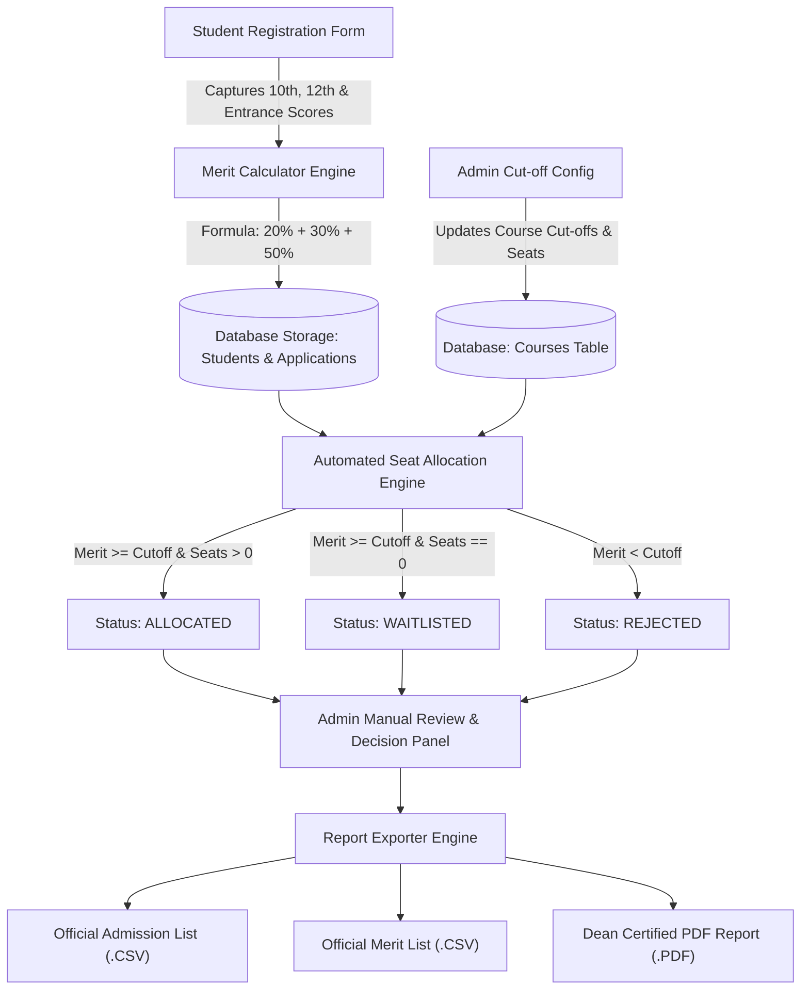
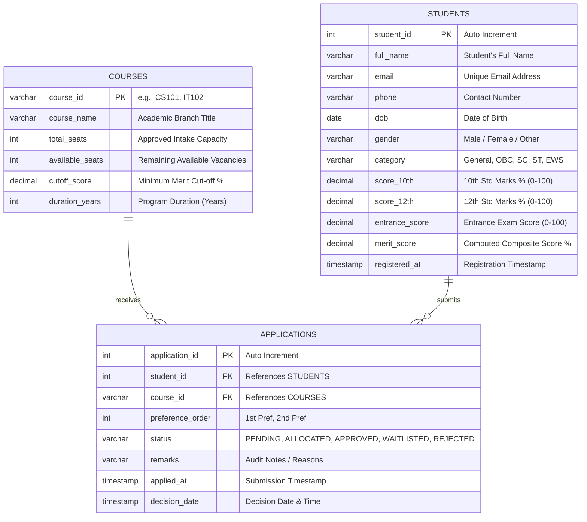

# College Admission Management System - User Guide

## 1. Executive Summary
The **College Admission Management System** is an enterprise-grade academic admissions desktop application built using **Java (JDK 17)**, **JDBC**, and **MySQL 8.0** (with an automatic embedded **SQLite** fallback). It manages the complete student admission lifecycle:
- Student Registration & academic scoring
- Real-time composite merit calculation
- Course catalogue and dynamic cut-off management
- Automated merit-based course allocation engine
- Administrator manual review and seat allocation
- Export of publication-ready admission lists in **CSV** and **PDF** formats
- Both an interactive **Swing Desktop GUI** and a **Console CLI**

---

## 2. System Architecture & Workflow



---

## 3. Database Schema Design

The system implements a relational schema across three primary tables:



---

## 4. Merit Calculation Logic

The composite merit score determines student ranking:

$$\text{Composite Merit Score} = (0.20 \times \text{Score}_{10\text{th}}) + (0.30 \times \text{Score}_{12\text{th}}) + (0.50 \times \text{Entrance Exam Score})$$

### Calculation Example:
| Academic Metric | Candidate Marks | Weightage | Contribution |
| :--- | :---: | :---: | :---: |
| **10th Standard Marks** | 92.50% | 20% (0.20) | **18.50%** |
| **12th Standard Marks** | 94.00% | 30% (0.30) | **28.20%** |
| **Entrance Exam Score** | 91.00% | 50% (0.50) | **45.50%** |
| **Final Composite Score** | — | — | **92.20%** |

---

## 5. Course Allocation Algorithm

When running the **Automated Seat Allocation Engine**:
1. All courses reset to their total approved intake capacity.
2. All submitted applications are retrieved and sorted by:
   $$\text{Merit Score} \downarrow \quad \text{then} \quad \text{Preference Order} \uparrow$$
3. For each candidate application:
   - If candidate is already allocated to their higher-preference choice, lower preferences are marked `CANCELLED`.
   - If $\text{Merit Score} \ge \text{Course Cut-off}$:
     - If $\text{Available Seats} > 0$: Status $\to$ `ALLOCATED`, Available Seats decremented by 1.
     - If $\text{Available Seats} = 0$: Status $\to$ `WAITLISTED` (Candidate qualified, but quota full).
   - If $\text{Merit Score} < \text{Course Cut-off}$:
     - Status $\to$ `REJECTED` (Score below minimum cutoff).

---

## 6. How to Run the Project

### Prerequisites:
- **Java Development Kit (JDK 17 or higher)** installed.
- (Optional) **MySQL 8.0 Server** running on `localhost:3306`. If MySQL is unavailable or credentials differ, the application automatically runs on embedded **SQLite**, ensuring zero setup friction!

### Quick Launch Scripts (Windows):
- **GUI Mode (Swing Desktop Window)**:
  Double-click `run_gui.bat` or run:
  ```powershell
  java -cp "bin;lib/*" com.college.admission.Main --gui
  ```
- **CLI Mode (Interactive Terminal Menu)**:
  Double-click `run_cli.bat` or run:
  ```powershell
  java -cp "bin;lib/*" com.college.admission.Main --cli
  ```
- **Recompile from Source**:
  Double-click `build.bat` or run:
  ```powershell
  javac -encoding UTF-8 -cp "lib/*" -d bin src/com/college/admission/model/*.java src/com/college/admission/dao/*.java src/com/college/admission/service/*.java src/com/college/admission/ui/console/*.java src/com/college/admission/ui/gui/*.java src/com/college/admission/Main.java
  ```

---

## 7. User Interface Guide

### GUI Overview:
- **Header Badge**: Displays real-time database connection status (`MySQL` or `SQLite Fallback`).
- **Tab 1 - Student Registration**:
  - Live merit calculation previews the score as the user enters marks.
  - Validates email uniqueness, phone numbers, and score ranges (0–100).
  - Submit button records student details and generates course applications.
- **Tab 2 - Courses & Cut-offs**:
  - Displays all academic branches, seat capacities, and cutoffs.
  - "Update Cut-off Score" button allows modifying requirements on the fly.
  - "Add New Course" dialog allows adding new engineering or degree programs.
- **Tab 3 - Merit List & Applications Review**:
  - Filter applicants by course or status (`PENDING`, `ALLOCATED`, etc.).
  - "Run Automated Seat Allocation" button triggers the allocation engine.
- **Tab 4 - Admin Decision Panel**:
  - Allows reviewing individual applicant dossiers.
  - Administrators can manually approve, reject, or enter custom remarks.
- **Tab 5 - Reports & Exports**:
  - One-click export to `output/admission_list.csv`.
  - One-click export to `output/merit_list.csv`.
  - One-click export to `output/admission_list.pdf` (OpenPDF publication format).
  - "Open Output Folder" button launches Windows Explorer in the `output/` directory.

---

## 8. Database Configuration (`db.properties`)

Edit `db.properties` at the project root to configure your database:
```properties
db.type=mysql
db.mysql.host=localhost
db.mysql.port=3306
db.mysql.name=college_admission_db
db.mysql.user=root
db.mysql.password=123456
db.sqlite.file=college_admission.db
```
The database connection can also be modified directly inside the GUI using **File $\to$ Database Connection Settings...** without modifying files manually!

---

## 9. Output Deliverables
Generated output files are saved in the `output/` folder:
- **`output/admission_list.csv`**: Comma-separated list of admitted students, courses, merit marks, and status.
- **`output/merit_list.csv`**: Complete ranked merit list of all registered applicants.
- **`output/admission_list.pdf`**: Formatted PDF document with university title, table styling, and signature blocks.
